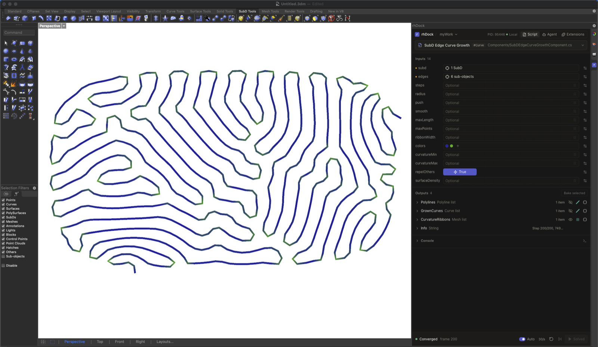

# RhinoDock

**Make it yours.** Your repository holds your tools. Your agent builds them with you. Your Extensions add what Rhino does not have. Save a file and Rhino updates, with no restart.



RhinoDock is experimental software for Windows and macOS. See [known limitations](docs/limitations.md) before using it on important work.

## What you get

- **Scripts.** Plain C# classes with a `Run(...)` method, kept in your own Working Repo. Inputs come from the signature; geometry is picked in Rhino. Preview is transient, and Bake adds the result to the document with undo.
- **Solvers.** A Script with a `Done` output runs frame by frame, with Solve, Pause, Step, and Reset.
- **Agents.** Pick an installed coding agent (Claude Code, Codex, OpenCode, Pi, and more) in the Agent tab. It writes and edits your Scripts and Extensions while you watch the diffs.
- **Extensions.** Add your own windows and Rhino behavior in C# and web pages that hot-reload like Scripts. The core stays small; you grow it.
- **Workspaces.** Inputs, picks, and display settings are saved per Script and restored when you reopen.

## Install

Build the Yak package and install it in Rhino. You need the .NET 8 SDK and Node.js 22.

```sh
git clone https://github.com/Daxler-design/RhinoDock.git
cd RhinoDock/frontend && npm ci && npm run build && cd ..
dotnet build rhdock.sln -c Release
dotnet msbuild tools/package-yak.proj
yak install .artifacts/yak/<package>.yak
```

<!-- Enable after the first `yak push`:
In Rhino, run `_PackageManager`, search for `rhdock`, and install it.
-->

Restart Rhino and run `RhinoDock`. Then follow [Getting started](docs/getting-started.md).

## Documentation

- [Getting started](docs/getting-started.md)
- [User guide](docs/user-guide.md) and [writing Scripts](docs/scripts.md)
- [Agent tab](docs/agent.md)
- [Extensions](docs/extensions.md) and [debugging](docs/debugging.md)
- [Known limitations](docs/limitations.md) and the [changelog](CHANGELOG.md)
- Contributors: [development](docs/development.md), [architecture](docs/architecture.md), [CONTRIBUTING](CONTRIBUTING.md), [security](SECURITY.md)

## Acknowledgments

Built with help from [shadcn/ui](https://github.com/shadcn-ui/ui) and [MonoCode](https://github.com/hardbeat920/monocode); see [third-party notices](THIRD-PARTY-NOTICES.md).

## License

[MIT](LICENSE). Rhino and external agents are separate products with their own terms.
